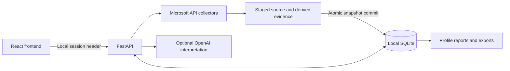

# Architecture

The application consists of a React/TypeScript/Vite frontend, a single FastAPI backend, and a local SQLite database accessed through async SQLAlchemy.

`backend/app/routers` defines API domains; `services` contains collectors and interpretation; `db_models` contains persistence models; `models` contains request/response schemas. `frontend/src/api` centralizes requests, `cache` and `hooks` coordinate profile-scoped loading, and `reporting` shapes report values.

Data Pull collects source modules through internal HTTP requests carrying the same local session, stages results in memory, then derives framework/insight modules. It commits all saved modules together after successful collection. Server-Sent Events report progress. A failed pull leaves earlier saved evidence intact.

Customer profiles are data partitions for one operator, not separate user accounts. Every sensitive endpoint requires a local application session. Cloud credentials are held only in process memory. A profile ID selects evidence and credentials only after session validation. Locking or session expiry clears the credential store; expiry is checked when an API request arrives. In-flight work may finish and should be allowed to settle before shutting down.

Report V2 separates snapshot evidence from stored interpretation runs and editable section text. User-triggered AI generation sends a grounding bundle to OpenAI only when configured. A deterministic local interpretation is available when it is not configured or a response fails validation. Reports and exports must never silently substitute another profile's content.

The current session implementation supports one backend process and one operator. Do not run multiple workers or place it behind a public proxy. HTTPS and multi-user authorization would require a separate deployment design; local HTTP is limited to loopback.
